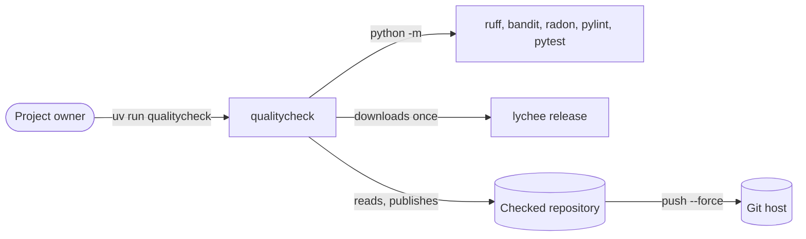
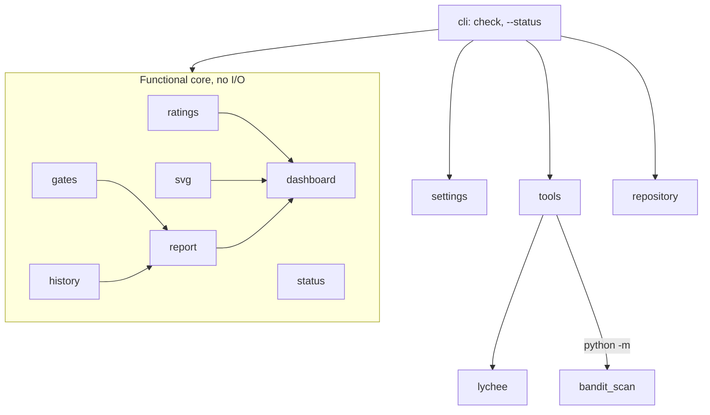

# Architecture

## Context

qualitycheck runs inside the checked project's environment: the tools are the project's own, at the versions its lock fixes.

## Containers

| Module | Role |
|---|---|
| `cli` | the two commands and their exit codes |
| `settings` | `[tool.qualitycheck]` and `fail_under` |
| `tools` | runs the tools, parses their outputs into `Measures` |
| `process` | runs a program and keeps its output as text, for `tools`, `repository` and `cli` |
| `bandit_scan` | runs bandit once, writing its JSON and `bandit.html` from the same scan |
| `lychee` | finds or downloads the pinned lychee; sorts its findings |
| `gates` | judges the measures: one gate each, PASS, FAIL or n/a |
| `report` | renders `report.md` |
| `dashboard` | the Sonar-like dashboard: its images and the Markdown showing them |
| `ratings` | Sonar's ratings, debt ratio, duplications and hotspots, for display only |
| `svg` | draws the gate banner, the tiles and the activity chart as SVG text |
| `history` | reads and appends `history.csv` |
| `status` | the reminder before a push |
| `repository` | refuses a dirty tree, continues the history, publishes the branch |

## Decisions

- [ADR 0001](adr/0001-publish-on-a-replaced-branch.md): publish on a replaced branch.
- [ADR 0002](adr/0002-pinned-lychee-download.md): download a pinned lychee.
