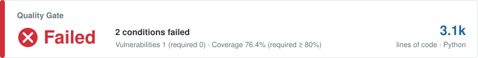
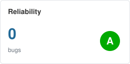
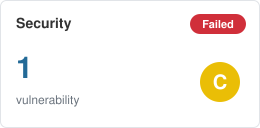
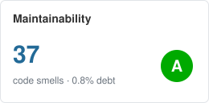
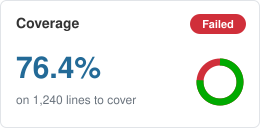
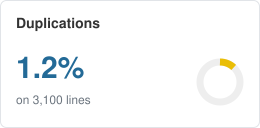
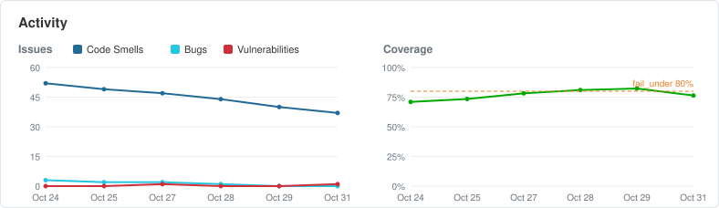

# Quality check report

> Mockup with fictional values: how a report close to Sonar's overview renders on GitHub.

- Tested commit: `3f2a9c1b7e`
- Date: 2026-10-31T10:00+01:00
- Result: **FAIL**
- Last passing commit: `9b1e4d2a0c`, 2026-10-29T18:12+01:00

## Gates

| Gate | Result | Detail |
|---|---|---|
| tests | PASS | 214 passed |
| bugs | PASS | 0 |
| vulnerabilities | FAIL | 1 medium or high |
| maintainability | PASS | every file A |
| duplication | PASS | 0 |
| complexity | PASS | 0 |
| coverage | FAIL | 76.4% (fail_under 80%) |
| links | PASS | 0 broken |

## Bugs

- none

## Vulnerabilities (medium and high)

- `src/demo/core.py:12` B307 MEDIUM: Use of possibly insecure function - consider using safer ast.literal_eval.

## Duplication

- none

## Low-severity vulnerabilities

- `src/demo/run.py:3` B404 LOW: Consider possible security implications associated with the subprocess module.
- `src/demo/run.py:9` B603 LOW: subprocess call - check for execution of untrusted input.
- `tests/test_run.py:5` B101 LOW: Use of assert detected.

## Smells

- `src/demo/core.py:4` E501: Line too long (104 > 88)
- *… 36 more*
