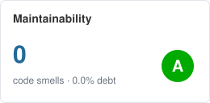
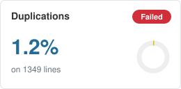
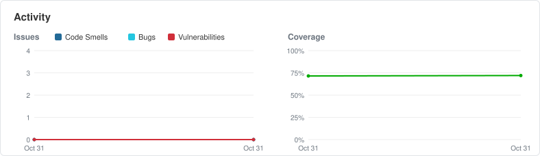

# Quality check report

- Tested commit: `9e73ea52ea`
- Date: 2026-10-31T16:18+01:00
- Result: **FAIL**
- Last passing commit: none yet

## Gates

| Gate | Result | Detail |
|---|---|---|
| tests | PASS | 118 passed, 3 warnings |
| bugs | PASS | 0 bug(s) |
| vulnerabilities | PASS | 0 medium or high |
| maintainability | PASS | 0 file(s) below A |
| duplication | FAIL | 1 duplicated block(s) |
| complexity | PASS | 0 function(s) too complex |
| coverage | n/a | 72.0% (no fail_under) |
| links | PASS | 0 broken link(s) |

## Metrics

| Metric | Value |
|---|---|
| Lines of code | 1349 |
| Smells | 0 |
| Low-severity vulnerabilities | 103 |
| Coverage | 72.0% |

## Bugs

- none

## Vulnerabilities (medium and high)

- none

## Complexity

- none

## Maintainability below A

- none

## Duplication

- Similar lines in 2 files: qualitycheck.repository:[25:35], qualitycheck.tools:[32:38]

## Smells (first 30)

- none

## Low-severity vulnerabilities

- `src/qualitycheck/cli.py:6` B404 Consider possible security implications associated with the subprocess module.
- `src/qualitycheck/cli.py:20` B607 Starting a process with a partial executable path
- `src/qualitycheck/cli.py:20` B603 subprocess call - check for execution of untrusted input.
- `src/qualitycheck/repository.py:4` B404 Consider possible security implications associated with the subprocess module.
- `src/qualitycheck/repository.py:22` B607 Starting a process with a partial executable path
- `src/qualitycheck/repository.py:22` B603 subprocess call - check for execution of untrusted input.
- `src/qualitycheck/tools.py:7` B404 Consider possible security implications associated with the subprocess module.
- `src/qualitycheck/tools.py:29` B603 subprocess call - check for execution of untrusted input.
- `src/qualitycheck/tools.py:189` B607 Starting a process with a partial executable path
- `src/qualitycheck/tools.py:189` B603 subprocess call - check for execution of untrusted input.
- `src/qualitycheck/tools.py:203` B603 subprocess call - check for execution of untrusted input.
- `tests/bdd/test_links.py:61` B101 Use of assert detected. The enclosed code will be removed when compiling to optimised byte code.
- `tests/bdd/test_links.py:62` B101 Use of assert detected. The enclosed code will be removed when compiling to optimised byte code.
- `tests/bdd/test_links.py:68` B101 Use of assert detected. The enclosed code will be removed when compiling to optimised byte code.
- `tests/bdd/test_links.py:78` B101 Use of assert detected. The enclosed code will be removed when compiling to optimised byte code.
- `tests/bdd/test_links.py:79` B101 Use of assert detected. The enclosed code will be removed when compiling to optimised byte code.
- `tests/bdd/test_publish.py:23` B101 Use of assert detected. The enclosed code will be removed when compiling to optimised byte code.
- `tests/bdd/test_publish.py:77` B101 Use of assert detected. The enclosed code will be removed when compiling to optimised byte code.
- `tests/bdd/test_publish.py:79` B101 Use of assert detected. The enclosed code will be removed when compiling to optimised byte code.
- `tests/bdd/test_publish.py:80` B101 Use of assert detected. The enclosed code will be removed when compiling to optimised byte code.
- `tests/bdd/test_publish.py:88` B101 Use of assert detected. The enclosed code will be removed when compiling to optimised byte code.
- `tests/bdd/test_publish.py:95` B101 Use of assert detected. The enclosed code will be removed when compiling to optimised byte code.
- `tests/bdd/test_publish.py:101` B101 Use of assert detected. The enclosed code will be removed when compiling to optimised byte code.
- `tests/bdd/test_publish.py:102` B101 Use of assert detected. The enclosed code will be removed when compiling to optimised byte code.
- `tests/bdd/test_publish.py:108` B101 Use of assert detected. The enclosed code will be removed when compiling to optimised byte code.
- `tests/bdd/test_publish.py:114` B101 Use of assert detected. The enclosed code will be removed when compiling to optimised byte code.
- `tests/bdd/test_publish.py:115` B101 Use of assert detected. The enclosed code will be removed when compiling to optimised byte code.
- `tests/bdd/test_publish.py:121` B101 Use of assert detected. The enclosed code will be removed when compiling to optimised byte code.
- `tests/bdd/test_publish.py:122` B101 Use of assert detected. The enclosed code will be removed when compiling to optimised byte code.
- `tests/bdd/test_publish.py:128` B101 Use of assert detected. The enclosed code will be removed when compiling to optimised byte code.
- `tests/bdd/test_publish.py:129` B101 Use of assert detected. The enclosed code will be removed when compiling to optimised byte code.
- `tests/bdd/test_publish.py:130` B101 Use of assert detected. The enclosed code will be removed when compiling to optimised byte code.
- `tests/bdd/test_publish.py:136` B101 Use of assert detected. The enclosed code will be removed when compiling to optimised byte code.
- `tests/bdd/test_publish.py:143` B101 Use of assert detected. The enclosed code will be removed when compiling to optimised byte code.
- `tests/bdd/test_publish.py:153` B101 Use of assert detected. The enclosed code will be removed when compiling to optimised byte code.
- `tests/bdd/test_publish.py:156` B101 Use of assert detected. The enclosed code will be removed when compiling to optimised byte code.
- `tests/bdd/test_publish.py:174` B101 Use of assert detected. The enclosed code will be removed when compiling to optimised byte code.
- `tests/bdd/test_publish.py:175` B101 Use of assert detected. The enclosed code will be removed when compiling to optimised byte code.
- `tests/bdd/test_quality_check.py:27` B101 Use of assert detected. The enclosed code will be removed when compiling to optimised byte code.
- `tests/bdd/test_quality_check.py:49` B101 Use of assert detected. The enclosed code will be removed when compiling to optimised byte code.
- `tests/bdd/test_quality_check.py:62` B101 Use of assert detected. The enclosed code will be removed when compiling to optimised byte code.
- `tests/bdd/test_quality_check.py:63` B101 Use of assert detected. The enclosed code will be removed when compiling to optimised byte code.
- `tests/bdd/test_quality_check.py:64` B101 Use of assert detected. The enclosed code will be removed when compiling to optimised byte code.
- `tests/bdd/test_quality_check.py:65` B101 Use of assert detected. The enclosed code will be removed when compiling to optimised byte code.
- `tests/bdd/test_quality_check.py:71` B101 Use of assert detected. The enclosed code will be removed when compiling to optimised byte code.
- `tests/bdd/test_quality_check.py:77` B101 Use of assert detected. The enclosed code will be removed when compiling to optimised byte code.
- `tests/bdd/test_quality_check.py:89` B101 Use of assert detected. The enclosed code will be removed when compiling to optimised byte code.
- `tests/bdd/test_quality_check.py:91` B101 Use of assert detected. The enclosed code will be removed when compiling to optimised byte code.
- `tests/bdd/test_quality_check.py:92` B101 Use of assert detected. The enclosed code will be removed when compiling to optimised byte code.
- `tests/bdd/test_quality_check.py:94` B101 Use of assert detected. The enclosed code will be removed when compiling to optimised byte code.
- `tests/bdd/test_quality_check.py:101` B101 Use of assert detected. The enclosed code will be removed when compiling to optimised byte code.
- `tests/bdd/test_status.py:130` B101 Use of assert detected. The enclosed code will be removed when compiling to optimised byte code.
- `tests/bdd/test_status.py:132` B101 Use of assert detected. The enclosed code will be removed when compiling to optimised byte code.
- `tests/bdd/test_status.py:135` B101 Use of assert detected. The enclosed code will be removed when compiling to optimised byte code.
- `tests/bdd/test_status.py:137` B101 Use of assert detected. The enclosed code will be removed when compiling to optimised byte code.
- `tests/bdd/test_status.py:138` B101 Use of assert detected. The enclosed code will be removed when compiling to optimised byte code.
- `tests/bdd/test_status.py:145` B101 Use of assert detected. The enclosed code will be removed when compiling to optimised byte code.
- `tests/bdd/test_visual_report.py:121` B101 Use of assert detected. The enclosed code will be removed when compiling to optimised byte code.
- `tests/bdd/test_visual_report.py:129` B101 Use of assert detected. The enclosed code will be removed when compiling to optimised byte code.
- `tests/bdd/test_visual_report.py:130` B101 Use of assert detected. The enclosed code will be removed when compiling to optimised byte code.
- `tests/bdd/test_visual_report.py:135` B101 Use of assert detected. The enclosed code will be removed when compiling to optimised byte code.
- `tests/bdd/test_visual_report.py:149` B101 Use of assert detected. The enclosed code will be removed when compiling to optimised byte code.
- `tests/bdd/test_visual_report.py:150` B101 Use of assert detected. The enclosed code will be removed when compiling to optimised byte code.
- `tests/bdd/test_visual_report.py:159` B101 Use of assert detected. The enclosed code will be removed when compiling to optimised byte code.
- `tests/bdd/test_visual_report.py:168` B101 Use of assert detected. The enclosed code will be removed when compiling to optimised byte code.
- `tests/bdd/test_visual_report.py:169` B101 Use of assert detected. The enclosed code will be removed when compiling to optimised byte code.
- `tests/bdd/test_visual_report.py:174` B101 Use of assert detected. The enclosed code will be removed when compiling to optimised byte code.
- `tests/bdd/test_visual_report.py:175` B101 Use of assert detected. The enclosed code will be removed when compiling to optimised byte code.
- `tests/bdd/test_visual_report.py:180` B101 Use of assert detected. The enclosed code will be removed when compiling to optimised byte code.
- `tests/bdd/test_visual_report.py:181` B101 Use of assert detected. The enclosed code will be removed when compiling to optimised byte code.
- `tests/bdd/test_visual_report.py:186` B101 Use of assert detected. The enclosed code will be removed when compiling to optimised byte code.
- `tests/bdd/test_visual_report.py:191` B101 Use of assert detected. The enclosed code will be removed when compiling to optimised byte code.
- `tests/bdd/test_visual_report.py:200` B101 Use of assert detected. The enclosed code will be removed when compiling to optimised byte code.
- `tests/bdd/test_visual_report.py:201` B101 Use of assert detected. The enclosed code will be removed when compiling to optimised byte code.
- `tests/bdd/test_visual_report.py:208` B101 Use of assert detected. The enclosed code will be removed when compiling to optimised byte code.
- `tests/bdd/test_visual_report.py:217` B101 Use of assert detected. The enclosed code will be removed when compiling to optimised byte code.
- `tests/bdd/test_visual_report.py:222` B101 Use of assert detected. The enclosed code will be removed when compiling to optimised byte code.
- `tests/bdd/test_visual_report.py:231` B101 Use of assert detected. The enclosed code will be removed when compiling to optimised byte code.
- `tests/bdd/test_visual_report.py:232` B101 Use of assert detected. The enclosed code will be removed when compiling to optimised byte code.
- `tests/bdd/test_visual_report.py:244` B101 Use of assert detected. The enclosed code will be removed when compiling to optimised byte code.
- `tests/bdd/test_visual_report.py:245` B101 Use of assert detected. The enclosed code will be removed when compiling to optimised byte code.
- `tests/bdd/test_visual_report.py:250` B101 Use of assert detected. The enclosed code will be removed when compiling to optimised byte code.
- `tests/conftest.py:9` B404 Consider possible security implications associated with the subprocess module.
- `tests/conftest.py:34` B607 Starting a process with a partial executable path
- `tests/conftest.py:34` B603 subprocess call - check for execution of untrusted input.
- `tests/conftest.py:49` B603 subprocess call - check for execution of untrusted input.
- `tests/conftest.py:209` B101 Use of assert detected. The enclosed code will be removed when compiling to optimised byte code.
- `tests/conftest.py:210` B101 Use of assert detected. The enclosed code will be removed when compiling to optimised byte code.
- `tests/conftest.py:230` B101 Use of assert detected. The enclosed code will be removed when compiling to optimised byte code.
- `tests/integration/test_reports.py:12` B101 Use of assert detected. The enclosed code will be removed when compiling to optimised byte code.
- `tests/unit/test_bandit_scan.py:29` B101 Use of assert detected. The enclosed code will be removed when compiling to optimised byte code.
- `tests/unit/test_dashboard.py:25` B101 Use of assert detected. The enclosed code will be removed when compiling to optimised byte code.
- `tests/unit/test_gates.py:15` B101 Use of assert detected. The enclosed code will be removed when compiling to optimised byte code.
- `tests/unit/test_history.py:15` B101 Use of assert detected. The enclosed code will be removed when compiling to optimised byte code.
- `tests/unit/test_history_row.py:16` B101 Use of assert detected. The enclosed code will be removed when compiling to optimised byte code.
- `tests/unit/test_lychee.py:15` B101 Use of assert detected. The enclosed code will be removed when compiling to optimised byte code.
- `tests/unit/test_lychee.py:24` B101 Use of assert detected. The enclosed code will be removed when compiling to optimised byte code.
- `tests/unit/test_lychee.py:26` B101 Use of assert detected. The enclosed code will be removed when compiling to optimised byte code.
- `tests/unit/test_reminder.py:21` B101 Use of assert detected. The enclosed code will be removed when compiling to optimised byte code.
- `tests/unit/test_report.py:20` B101 Use of assert detected. The enclosed code will be removed when compiling to optimised byte code.
- `tests/unit/test_repository.py:10` B101 Use of assert detected. The enclosed code will be removed when compiling to optimised byte code.
- `tests/unit/test_settings.py:13` B101 Use of assert detected. The enclosed code will be removed when compiling to optimised byte code.
- `tests/unit/test_tools.py:12` B101 Use of assert detected. The enclosed code will be removed when compiling to optimised byte code.

## Broken links

- none

## Trend

| date | commit | result | bugs | vulnerabilities | smells | coverage |
|---|---|---|---|---|---|---|
| 2026-10-31T16:11+01:00 | 898494bc6a | FAIL | 0 | 0 | 0 | 71.5 |
| 2026-10-31T16:18+01:00 | 9e73ea52ea | FAIL | 0 | 0 | 0 | 72.0 |

Regenerate: `uv run qualitycheck`.
